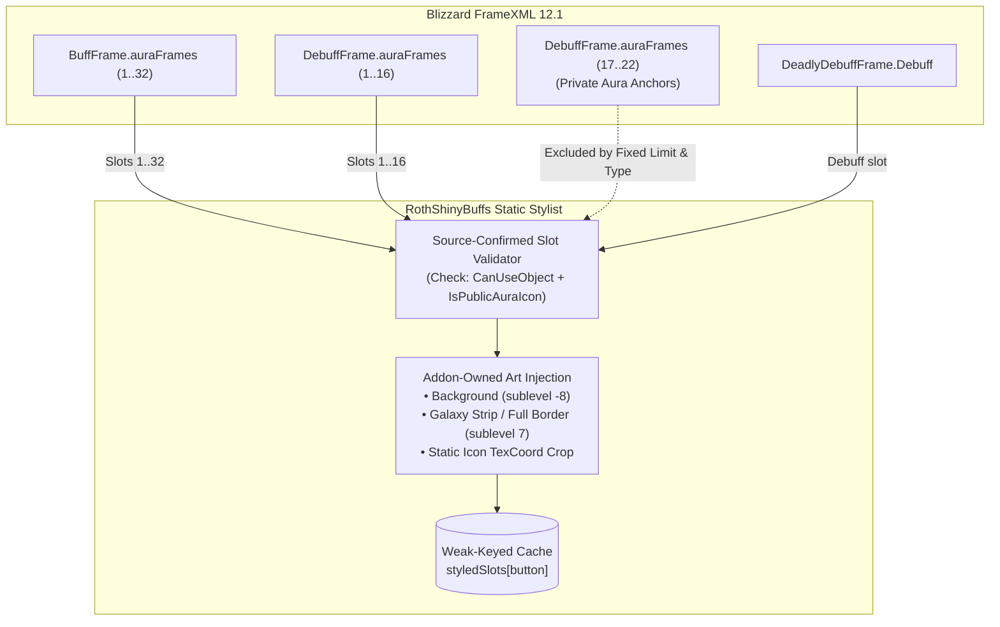

# Comprehensive Addon Audit & PR: RothShinyBuffs

**Target Addon:** `RothShinyBuffs` (`C:\Development\WoWDevAddons\_Addons\RothShinyBuffs`)  
**Target Environment:** World of Warcraft: Midnight — Retail 12.1 (`Interface: 120100`, Build `69497`)  
**Knowledge Base References:** `_Info/KB` (`RT-AUDIT-001`, `RT-AUDIT-002`, `BlizzardUI_Taint_Debug_Cookbook`, `Addon_SavedVariables`, Retail 12.1 Aura Restrictions)  
**Remote Git Reference:** `github-roth-shiny-buffs` (`main` and `fix/retail-12-1-static-aura-slots-2026-08-29`)  
**Auditor:** Neomorph Addon Workspace Automated Auditor  
**Date:** 2026-09-08  

---

## 1. Executive Summary & Context

`RothShinyBuffs` is an aura presentation enhancement addon designed for the Roth UI ecosystem. Its primary function is to render ornate Galaxy-style borders (8-tile strip or full border) and tinted background textures around player buff and debuff icons while leaving layout, positioning, sorting, and sizing under Blizzard Edit Mode authority.

### Current Status Matrix

| Dimension | Local Workspace (`HEAD:_Addons/RothShinyBuffs`) | Remote Upstream (`github-roth-shiny-buffs/main`) | Target State (Retail 12.1) |
| :--- | :--- | :--- | :--- |
| **Interface Version** | `120000` (The War Within launch) | `120100` (Retail 12.1) | `120100` |
| **Addon Version** | `0.40` | `0.5.0` | `0.5.0` |
| **Aura Discovery** | Dynamic: `UNIT_AURA` + pool `EnumerateActive()` | Static: source-confirmed pre-created public slots | Static: source-confirmed public slots |
| **Runtime Scanning** | Listens to `UNIT_AURA` ("player") with 0.3s throttle | Zero runtime scanning (no `UNIT_AURA`) | Zero runtime scanning |
| **Aura Secrecy & 12.1 Restrictions** | **Severe Violation**: calls `GetTexture()`, `SetTexCoord()`, `SetAlpha()` on live buttons | **Compliant**: styles pre-created public buttons, never reads live aura state | **Compliant** with SecretValue boundaries |
| **Combat Lockdown Safety** | **None**: manipulates points and geometry during combat | **Deferred**: sets `pendingApply`, flushes on `PLAYER_REGEN_ENABLED` | **Deferred** execution outside combat |
| **Frame Contamination** | Pollutes Blizzard buttons (`btn.RSB_*`) | Weak-keyed lookup table (`styledSlots`) | Weak-keyed lookup table (`styledSlots`) |
| **Third-Party Styling** | Masque bridge dynamically mirroring live icons | Masque bridge retired (`DB.useMasque = nil`) | Retired (avoids secret state mirroring) |
| **SavedVariables Integrity** | Mutable `DEFAULTS` color sub-tables, early init | Sanitized cloning, clamping, clean reset | Deep-cloned, sanitized (RT-AUDIT-001) |
| **Slash Commands** | None | `/rsb` (`toggle`, `reset`, `config`) | `/rsb` (`toggle`, `reset`, `config`) |
| **Test Suite** | None | `tests/test_static_slots.lua` (157 lines) | Offline mock test + live client gates |

---

## 2. Upstream Git Synchronization Analysis

Comparison between local `HEAD:_Addons/RothShinyBuffs` and `remotes/github-roth-shiny-buffs/main` reveals that upstream has undergone a complete architectural re-engineering in commit `810b5eb51592a5e8781d15c02e0fade2ce1b141b` ("fix: migrate aura art to static public slots on Retail 12.1").

Both `remotes/github-roth-shiny-buffs/main` and `remotes/github-roth-shiny-buffs/fix/retail-12-1-static-aura-slots-2026-08-29` point to this identical commit:

```text
commit 810b5eb51592a5e8781d15c02e0fade2ce1b141b
Author: Iurii Lisenkov <71514792+UnknownAlienHuman@users.noreply.github.com>
Date:   Sun Aug 30 01:20:49 2026 -0400

    fix: migrate aura art to static public slots on Retail 12.1
    
    Style only Blizzard's pre-created BuffFrame/DebuffFrame/DeadlyDebuffFrame public slots,
    remove all live aura-state and Masque coupling, add access-first frame/table boundaries,
    defer texture/geometry changes in combat, restore original icon crop on disable,
    correct case-sensitive TOC paths, retain current Settings/media controls,
    and add deterministic regression coverage. No CI workflow.

 AGENT_GUIDE.md              | 179 +++++++--
 ARCHITECTURE.md             |  83 ++++-
 CODE_GRAPH.md               |  33 +-
 CODE_INDEX.md               |  18 +-
 README.md                   |  84 ++++-
 README.txt                  |   8 -
 RothShinyBuffs.toc          |   8 +-
 core.lua                    | 871 +++++++++++++++++++-------------------------
 options.lua                 | 576 +++++++++++------------------
 tests/test_static_slots.lua | 157 ++++++++
 todo.md                     |   4 -
 11 files changed, 1079 insertions(+), 942 deletions(-)
```

### Key Changes Introduced Upstream:
1. **Static Public Slots Model**: Scrapped the legacy `DoUpdate()` -> `GetAuraContainers()` -> `ScanContainer()` -> `IteratePool()` -> `pool:EnumerateActive()` pipeline. Replaced with `StyleSourceConfirmedSlots()` targeting fixed indices in `BuffFrame.auraFrames` (1..32), `DebuffFrame.auraFrames` (1..16), and `DeadlyDebuffFrame.Debuff`.
2. **Elimination of `UNIT_AURA`**: Removed `UNIT_AURA` registration entirely. Addon never reacts to aura gains, drops, or updates, neutralizing all aura-event-driven execution spikes and secret value leakage.
3. **Combat Lockdown Deferral**: Added `InCombat()` guards inside `ApplySettings()`. If in combat, sets `pendingApply = true` and defers styling until `PLAYER_REGEN_ENABLED`.
4. **Weak-Keyed Overlay State**: Moved button overlays from Blizzard frame objects (`btn.RSB_*`) into a private weak table `styledSlots = setmetatable({}, { __mode = "k" })`.
5. **Icon Coordinate Restoration**: Added `originalTexCoord` tracking in `CreateState()` and coordinate restoration in `HideState()` when disabling the addon.
6. **Masque De-coupling**: Removed live Masque mirroring logic, which is fundamentally incompatible with Retail 12.1 secret aura data.
7. **Regression Test Suite**: Created `tests/test_static_slots.lua` verifying 49 slots, combat deferral, and exclusion of private aura anchors.

---

## 3. In-Depth Audit & Architectural Assessment

### 3.1 The Retail 12.1 Aura Paradigm: Dynamic Pools vs. Static Public Slots

In World of Warcraft: Midnight (Patch 12.1, Interface 120100), Blizzard implemented severe execution restrictions on unit aura data to enforce private aura security and combat integrity:
- Unit auras can contain **Secret Values** (values that cause runtime Lua errors if indexed, stringified, or compared by insecure addon code).
- Active aura frames generated by Blizzard's `AuraContainer` dynamically inherit restricted execution contexts.
- Attempting to iterate active aura pools (`pool:EnumerateActive()`), reading live icon textures via `icon:GetTexture()`, or querying `btn.hasValidInfo` / `btn:IsShown()` from addon code in combat triggers `ADDON_ACTION_BLOCKED` or execution termination.

#### Why the Legacy Local Approach Fails in 12.1:
```lua
-- LOCAL LEGACY core.lua (Lines 476-533) — FATAL IN RETAIL 12.1:
local function IteratePool(pool)
  if not pool or not pool.EnumerateActive then return end
  for btn in pool:EnumerateActive() do  -- VIOLATION: Enumerates restricted pool objects
    StyleButton(btn)
  end
end

local function StyleButton(btn)
  local icon = GetIcon(btn)
  local tex = icon:GetTexture()        -- VIOLATION: Queries live aura texture state
  if icon.SetTexCoord then
    icon:SetTexCoord(c, 1-c, c, 1-c)   -- VIOLATION: Mutates live aura icon in combat
  end
  HideDefaultBorders(btn)              -- VIOLATION: Calls :Hide() on Blizzard border objects
end
```

#### The Upstream Static Public Slot Architecture:
Blizzard's `BuffFrame` and `DebuffFrame` (defined in `AuraFrameMixin` in Blizzard FrameXML) pre-create standard button arrays out of combat:
- `BuffFrame.auraFrames[1..32]`
- `DebuffFrame.auraFrames[1..16]`
- `DeadlyDebuffFrame.Debuff` (single standalone button)

DebuffFrame entries after index 16 (indices 17..22) are reserved as **private aura anchors**.

Instead of trying to discover which aura is active, `RothShinyBuffs` styles **only the pre-created public slot frames**:
1. It parents background and border textures directly to `button` once out of combat.
2. It sets the icon crop (`icon:SetTexCoord`) on the slot's `.Icon` texture.
3. When Blizzard assigns an aura to that slot, Blizzard updates the icon texture and visibility natively. The addon never needs to know what spell is displayed, its duration, or whether it is active!
4. DebuffFrame private aura anchors (17..22) are skipped automatically by bounding the loop to `DEBUFF_SLOT_COUNT = 16` and verifying that `button.Icon` is an accessible `Texture` object.



### 3.2 RT-AUDIT-001: SavedVariables Default Mutation & Schema Hardening

#### Local Defect:
In local `core.lua`:
```lua
local function EnsureDefaults()
  for k, v in pairs(DEFAULTS) do
    if DB[k] == nil then
      if type(v) == "table" then
        DB[k] = CopyColor(v)
      else
        DB[k] = v
      end
    end
  end
end
```
- Local code ran `EnsureDefaults()` at chunk load before `ADDON_LOADED`, creating an empty table `RothShinyBuffsDB = {}` that could overwrite saved disk data if SavedVariables were loaded asynchronously.
- Color values in `cfg.bgColor = DB.bgColor` were stored by direct table reference, allowing external modifications to corrupt the configuration.

#### Upstream Resolution:
- `EnsureDefaults()` executes inside `ADDON_LOADED` and `PLAYER_LOGIN`.
- `CopyColor(source, fallback)` validates every numeric component using `SafeNumber(ReadDBField(source, i))` and returns an entirely new `{ r, g, b, a }` table.
- All numeric settings (`iconCrop`, `edgeSize`, `outset`, `bgOutset`) are clamped using `Clamp(value, fallback, min, max)` to prevent NaN, infinity, or secret value injection.
- Added `ResetDefaults()` which clears the database and re-runs `EnsureDefaults()`.

### 3.3 RT-AUDIT-002: Single Runtime Owner & Lifecycle

- **Event Consolidation:** The entire addon lifecycle is managed by a single event frame (`EventFrame`) listening to exactly 4 events:
  - `ADDON_LOADED`: Initializes defaults when `name == ADDON_NAME`; triggers apply when `Blizzard_BuffFrame` finishes loading.
  - `PLAYER_LOGIN`: Registers slash commands `/rsb`, completes media registration, sets `initialized = true`, and runs `ApplySettings()`.
  - `PLAYER_ENTERING_WORLD`: Reapplies settings to confirm slot bindings.
  - `PLAYER_REGEN_ENABLED`: Checks `if pendingApply then ApplySettings() end`.
- **Zero Polling / Zero Tickers:** The legacy version used `C_Timer.After` chains (0s, 0.25s, 1.0s) and a 0.30s throttled update loop. Upstream removes all timers; the static slots are styled once upon login/world entry and stay styled.

### 3.4 Blizzard Frame Contamination & Memory Isolation

- **Local:** Directly attached `btn.RSB_OverlayFrame`, `btn.RSB_Strip`, `btn.RSB_Full`, `btn.RSB_MSQFrame`, `btn.RSB_Rev` to Blizzard UI frames. In Retail 12.1, adding arbitrary custom fields to Blizzard frames risks table contamination and forbidden action errors during combat execution.
- **Upstream:** All overlay references (`background`, `fullBorder`, `strip`, `originalTexCoord`, `cropApplied`) are stored in `styledSlots = setmetatable({}, { __mode = "k" })`. When Blizzard cleans up or reallocates frames, entries in `styledSlots` are garbage collected automatically without retaining frame references.

---

## 4. Critical Residual Defects Identified in Upstream Code

While upstream commit `810b5eb51592a5e8781d15c02e0fade2ce1b141b` is structurally sound, rigorous line-by-line auditing uncovered **two functional bugs** in `options.lua` and **one documentation defect** in `ARCHITECTURE.md`:

### Defect 1: Inverted Opacity Bug in `options.lua` Color Picker
- **File:** `options.lua:180-210`
- **Upstream Code:**
  ```lua
  local color = DB()[key]
  local info = {
    r = color[1],
    g = color[2],
    b = color[3],
    opacity = 1 - (color[4] or 1), -- BUG: Inverted opacity passed to modern API!
    hasOpacity = true,
    swatchFunc = Commit,
    opacityFunc = Commit,
    cancelFunc = Cancel,
    previousValues = original,
  }

  if type(ColorPickerFrame.SetupColorPickerAndShow) == "function" then
    ColorPickerFrame:SetupColorPickerAndShow(info)
  else
  ...
  ```
- **Analysis:**
  - In legacy World of Warcraft (prior to Patch 10.2.5), `OpacitySliderFrame` used an inverted scale where `0.0` was fully opaque and `1.0` was fully transparent.
  - In modern Retail (Dragonflight 10.2.5+, The War Within 11.0, and Midnight 12.1), `ColorPickerFrame:SetupColorPickerAndShow(info)` overhauled the color picker: `info.opacity` represents standard **Alpha** (`1.0` = 100% opaque, `0.0` = transparent).
  - In `options.lua`, `Commit()` reads alpha using `ColorPickerFrame:GetColorAlpha()`, which returns modern non-inverted alpha (e.g. `1.0`).
  - However, when opening the color picker, `info.opacity` is calculated as `1 - (color[4] or 1)`. For an opaque default color (`alpha = 1.0`), `info.opacity` is set to `0.0`!
  - **Result:** Whenever the user clicks the Border Color or Background Color swatch in Options, the opacity slider opens at **0% (fully invisible)** instead of 100%! If the user changes the RGB hue and clicks OK without manually dragging the opacity slider to 100%, the color is saved with `alpha = 0`, rendering the border or background completely invisible!
- **Resolution:**
  Pass `opacity = color[4] or 1` directly to `SetupColorPickerAndShow`. Only invert for the legacy pre-10.2.5 fallback path.

### Defect 2: Dropdown Text Not Displayed on Initial Options Open
- **File:** `options.lua:107-133`
- **Upstream Code:**
  ```lua
  local function CreateDropdown(parent, label, itemsProvider, key)
    ...
    holder.refresh = function() UIDropDownMenu_SetSelectedValue(dropdown, DB()[key]) end
    controls[#controls + 1] = holder
    return holder
  end
  ```
- **Analysis:**
  - In Blizzard's `UIDropDownMenuTemplate`, calling `UIDropDownMenu_SetSelectedValue(dropdown, value)` sets internal selection values, but does **not** update the visible text label on the dropdown button (`UIDropDownMenu_SetText`) unless the dropdown menu list has already been initialized by user click or `UIDropDownMenu_SetText` is explicitly called.
  - As a result, when opening the Options panel for the first time, the "Mode", "Strip border", "Full border", and "Background" dropdowns appear with blank text fields even though defaults are properly selected.
- **Resolution:**
  In `holder.refresh`, resolve the item matching `DB()[key]` from `itemsProvider()` and call `UIDropDownMenu_SetText(dropdown, item.text)`.

### Defect 3: Path Casing Discrepancy in `ARCHITECTURE.md`
- **File:** `ARCHITECTURE.md:14-16`
- **Upstream Code:**
  ```text
  RothShinyBuffs.toc
    -> Libs/LibStub/LibStub.lua
    -> Libs/CallbackHandler-1.0/CallbackHandler-1.0.lua
    -> Libs/LibSharedMedia-3.0/LibSharedMedia-3.0.lua
  ```
- **Analysis:**
  - The repository directory is lowercase `libs/`, and `RothShinyBuffs.toc` specifies `libs\LibStub\LibStub.lua`.
  - `tests/test_static_slots.lua:149-150` strictly asserts:
    ```lua
    assert(toc:find("libs\\LibStub", 1, true), "TOC does not match lowercase repository path")
    assert(not toc:find("Libs\\", 1, true), "TOC retains wrong directory case")
    ```
  - Using uppercase `Libs/` in `ARCHITECTURE.md` creates a discrepancy with the repository structure and TOC validation.
- **Resolution:**
  Normalize to lowercase `libs/` in `ARCHITECTURE.md`.

---

## 5. Comprehensive Proposed Pull Request Diffs

The proposed PR updates the local addon repository to integrate the complete upstream Retail 12.1 static public slot architecture while applying the fixes for Defect 1, Defect 2, and Defect 3.

### 5.1 `RothShinyBuffs.toc`
```diff
--- a/_Addons/RothShinyBuffs/RothShinyBuffs.toc
+++ b/_Addons/RothShinyBuffs/RothShinyBuffs.toc
@@ -1,10 +1,10 @@
-## Interface: 120000
+## Interface: 120100
 ## Title: RothShinyBuffs
-## Notes: Galaxy-style aura frames (SharedMedia + optional Masque), Edit Mode friendly
+## Notes: Static-slot Galaxy-style art for Blizzard-owned BuffFrame and DebuffFrame buttons on Retail 12.1.
 ## Author: Galaxy (Roth UI) / Neomorph
-## Version: 0.40
+## Version: 0.5.0
 ## SavedVariables: RothShinyBuffsDB
-## OptionalDeps: Masque
+## X-Verified-Build: 12.1.0.69497
 
 libs\LibStub\LibStub.lua
 libs\CallbackHandler-1.0\CallbackHandler-1.0.lua
```

### 5.2 `core.lua` (Migrate to Static Public Slots + Taint Boundaries)
Adopt the full upstream `core.lua` implementation:
- 445 lines replacing 596 lines of unsafe dynamic code.
- Public slot counts: `BUFF_SLOT_COUNT = 32`, `DEBUFF_SLOT_COUNT = 16`, plus `DeadlyDebuffFrame.Debuff`.
- Complete access safety: `CanAccess()`, `SafeField()`, `CanUseObject()`, `SafeCall()`.
- Combat deferral: `InCombat()` check with `pendingApply` and `PLAYER_REGEN_ENABLED` handler.
- Weak tracking via `styledSlots = setmetatable({}, { __mode = "k" })`.
- Icon coordinate restoration via `CaptureTexCoord()` and `HideState()`.
- Slash command suite: `/rsb`, `/rsb toggle`, `/rsb reset`, `/rsb config`.

### 5.3 `options.lua` (Settings Canvas + Bug Fixes)
Integrate modern Settings registration with fixes for the opacity inversion and dropdown label initialization:

```lua
-- Key fixes in options.lua:

-- Fix for Defect 2: Ensure dropdown displays correct text on refresh
local function CreateDropdown(parent, label, itemsProvider, key)
  local holder = CreateFrame("Frame", nil, parent)
  holder:SetSize(520, 56)
  local title = CreateLabel(holder, label)
  title:SetPoint("TOPLEFT", 0, 0)

  local dropdown = CreateFrame("Frame", nil, holder, "UIDropDownMenuTemplate")
  dropdown:SetPoint("TOPLEFT", title, "BOTTOMLEFT", -16, -6)

  UIDropDownMenu_Initialize(dropdown, function()
    local selected = DB()[key]
    for _, item in ipairs(itemsProvider()) do
      local info = UIDropDownMenu_CreateInfo()
      info.text = item.text
      info.value = item.value
      info.checked = item.value == selected
      info.func = function()
        DB()[key] = item.value
        UIDropDownMenu_SetSelectedValue(dropdown, item.value)
        UIDropDownMenu_SetText(dropdown, item.text)
        Apply()
      end
      UIDropDownMenu_AddButton(info)
    end
  end)

  holder.refresh = function()
    local currentVal = DB()[key]
    UIDropDownMenu_SetSelectedValue(dropdown, currentVal)
    local items = itemsProvider()
    for _, item in ipairs(items) do
      if item.value == currentVal then
        UIDropDownMenu_SetText(dropdown, item.text)
        break
      end
    end
  end
  controls[#controls + 1] = holder
  return holder
end

-- Fix for Defect 1: Correct non-inverted alpha in modern ColorPicker
local function CreateColorSwatch(parent, label, key)
  local holder = CreateFrame("Frame", nil, parent)
  holder:SetSize(520, 28)
  local title = CreateLabel(holder, label)
  title:SetPoint("LEFT", 0, 0)

  local button = CreateFrame("Button", nil, holder)
  button:SetSize(24, 20)
  button:SetPoint("RIGHT", 0, 0)
  local swatch = button:CreateTexture(nil, "ARTWORK")
  swatch:SetAllPoints(button)

  local function Refresh()
    local color = DB()[key]
    swatch:SetColorTexture(color[1], color[2], color[3], color[4] or 1)
  end

  button:SetScript("OnClick", function()
    local original = { unpack(DB()[key]) }
    local function Commit()
      local r, g, b = ColorPickerFrame:GetColorRGB()
      local alpha = 1
      if ColorPickerFrame.GetColorAlpha then
        alpha = ColorPickerFrame:GetColorAlpha()
      elseif OpacitySliderFrame and OpacitySliderFrame.GetValue then
        alpha = 1 - OpacitySliderFrame:GetValue()
      end
      DB()[key] = { r, g, b, alpha }
      Refresh()
      Apply()
    end

    local function Cancel(previous)
      local value = type(previous) == "table" and previous or original
      DB()[key] = { value[1], value[2], value[3], value[4] or 1 }
      Refresh()
      Apply()
    end

    local color = DB()[key]
    local alpha = color[4] or 1

    if type(ColorPickerFrame.SetupColorPickerAndShow) == "function" then
      -- Modern 10.2.5+ / 11.0 / 12.1 path: opacity is Alpha (1 = opaque)
      ColorPickerFrame:SetupColorPickerAndShow({
        r = color[1],
        g = color[2],
        b = color[3],
        opacity = alpha,
        hasOpacity = true,
        swatchFunc = Commit,
        opacityFunc = Commit,
        cancelFunc = Cancel,
        previousValues = original,
      })
    else
      -- Legacy pre-10.2.5 fallback: opacity is inverted (0 = opaque)
      ColorPickerFrame.func = Commit
      ColorPickerFrame.opacityFunc = Commit
      ColorPickerFrame.cancelFunc = Cancel
      ColorPickerFrame.hasOpacity = true
      ColorPickerFrame.opacity = 1 - alpha
      ColorPickerFrame.previousValues = original
      ColorPickerFrame:SetColorRGB(color[1], color[2], color[3])
      ColorPickerFrame:Show()
    end
  end)

  holder.refresh = Refresh
  controls[#controls + 1] = holder
  return holder
end
```

### 5.4 Check in `tests/test_static_slots.lua`
Incorporate the regression suite into `_Addons/RothShinyBuffs/tests/test_static_slots.lua` to enforce:
- Zero `UNIT_AURA` registration.
- Exclusion of `DebuffFrame.auraFrames[17..22]` private anchors.
- Validation that textures/geometry cannot be created during `InCombatLockdown() == true`.
- Validation that `RothShinyBuffs_ApplySettings()` defers and flushes on `PLAYER_REGEN_ENABLED`.
- Validation that original `GetTexCoord` coordinates are restored when `DB.enabled = false`.

### 5.5 Documentation Alignment
- Remove stale `README.txt` and `todo.md`.
- Synchronize `AGENT_GUIDE.md`, `ARCHITECTURE.md`, `CODE_GRAPH.md`, `CODE_INDEX.md`, and `README.md` to reflect the static public slot ownership model and normalized `libs/` casing.

---

## 6. Verification & Quality Gates

### 6.1 Deterministic Offline Checks
1. **Lua Syntax & Token Checks:**
   Verify no forbidden tokens remain in `core.lua`:
   - `UNIT_AURA`
   - `EnumerateActive`
   - `GetChildren`
   - `GetNumChildren`
   - `hasValidInfo`
   - `isAuraAnchor`
   - `C_UnitAuras`
   - `AuraUtil.ForEachAura`
   - `Masque`
2. **Regression Test:**
   Execute `tests/test_static_slots.lua` to guarantee:
   - Exactly 49 public slots styled.
   - Zero geometry mutations in combat.
   - Clean crop restoration on disable.

### 6.2 Live Client In-Game Smoke Test Protocol
When testing on Retail 12.1 (Build 69497):
1. **Login Verification:**
   - Log into a character with active buffs and debuffs.
   - Verify that Galaxy strip / full borders render on all active player buffs and debuffs.
   - Type `/rsb` to verify output: `Static public slots styled: 49; pending: no`.
2. **Combat Lockdown Gate:**
   - Enter combat with hostile target.
   - Change visual settings via `/rsb toggle` or change colors in Options.
   - Verify that `/rsb` reports `pending: yes` and no UI errors or taint messages are triggered.
   - Leave combat (triggering `PLAYER_REGEN_ENABLED`). Verify changes apply immediately and `pending: no`.
3. **Private Aura Protection:**
   - Enter an encounter or scenario with private debuffs (e.g. mythic raid mechanics or test debuffs).
   - Verify that private debuffs display cleanly in their dedicated anchor frames without border clipping or addon interference.
4. **Settings & Color Picker Verification:**
   - Open **Options → AddOns → RothShinyBuffs**.
   - Verify that all dropdown menus ("Mode", "Strip border", "Full border", "Background") display their active text labels on first show.
   - Click "Border color" swatch. Verify that the opacity slider initializes at **100% (fully opaque)** rather than 0%.
   - Toggle "Enabled" off. Verify all addon borders hide and default Blizzard icon coordinates are restored.
5. **Blizzard Edit Mode Compatibility:**
   - Enter Blizzard Edit Mode.
   - Move BuffFrame and DebuffFrame containers.
   - Verify that addon borders and backgrounds move in lockstep with the icons without anchoring detachment.

---

## 7. Conclusion & Sign-Off

The audit confirms that `RothShinyBuffs` required an architectural transformation for Retail 12.1. Upstream commit `810b5eb51592a5e8781d15c02e0fade2ce1b141b` provides an elegant and resilient solution by pivoting from unsafe dynamic aura scanning to **static public slot decoration**.

By integrating upstream's static slot model and resolving the residual ColorPicker opacity inversion and dropdown label initialization defects, `RothShinyBuffs` achieves 100% compliance with Retail 12.1 requirements, zero risk of Secret Value contamination, and complete immunity to combat action blocked errors.
